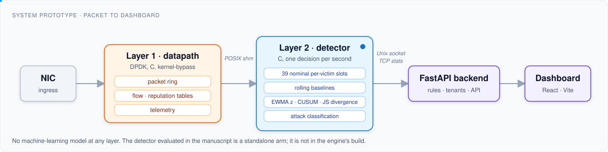

<div align="center">



<br> 

[](LICENSE)
[](ComparisonResults/)
[](datasets/README.md)
[](project/)
[](project/dashboard)

**Reported DDoS-detector performance rests on evaluation choices that are rarely audited.<br>This repository holds the protocol that audits them, the records it produced, and the prototype it was run against.**

</div>

<br>

## What applying the protocol changed

The manuscript *A Clock Can Score Like a DDoS Detector: How Split Construction and Scoring
Protocol Manufacture Training-Free Benchmark Results* applies four checks to four public corpora
(CIC-IDS-2017, CSE-CIC-IDS2018, CIC-DDoS2019 and LITNET-2020): which victim–scenario slices are
admissible, whether a library baseline scores a row independently of the batch it arrives in,
what the unit of statistical analysis is, and whether a scorer that reads only the window index
already separates the test stream. The contribution is the protocol and the measurement of what
it changes, not a new detector. Hyperparameters, cuts and the four-corpus scope were chosen after
seeing results, and no p-value in the manuscript is confirmatory.



| Check | What it changed on the four corpora |
| :-- | :-- |
| Admissibility | 31 candidate scenarios, one recorded verdict each; 16 admitted, on five victim hosts. |
| Batch-invariant scoring | Inductive re-scoring raises the mean AUC of three library baselines (ECOD, COPOD, DIF) by 0.29 to 0.45. |
| Unit of analysis | On the detector's mean AUC advantage over the peaks-over-threshold (POT) reference, +0.0246, the i.i.d. bootstrap interval [0.0040, 0.0541] excludes zero; resampled by victim host, the interval [−0.0050, 0.0499] spans it. |
| Clock-only null | The causal split puts every pre-attack benign window into fit and calibration, so each test stream opens on attack, and a scorer that reads only the window index reaches AUC 0.95 or more on 15 of the 16 admitted scenarios. Returning the last fifth of that benign slice to the test stream leaves 3. |

## How the system is built

A DPDK packet datapath in C, a statistical detector in C that decides once per second, and a
web control plane. No machine-learning model anywhere.



## What the evaluation found

Every number below comes from the deposited records in
[`ComparisonResults/results/`](ComparisonResults/results/), directly or through the scripts in
[`ComparisonResults/recompute/`](ComparisonResults/recompute/). On the 16 admitted scenarios:

- The detector's mean AUC is 0.9913 against 0.9667 for the POT reference, a difference of +0.0246
  (scenario-level Holm-adjusted p = 0.064). One scenario, CIC-IDS-2017
  `Wed-05-07_DoS-Slowhttptest`, carries 53.8% of the summed per-scenario difference, and on it the
  clock-only null (AUC 0.9927) scores higher than the detector (0.9875).
- When every arm gets the same EWMA smoothing stage, the detector leads the runner-up, DIF, by
  0.0004 in mean AUC, and the equally smoothed reference records fewer benign alarm episodes than
  the detector at every oracle target. At 1% the detector records more episodes than that reference
  on 9 of the 16 scenarios and fewer on 2 (scenario-level p = 0.041 against the detector;
  victim-clustered p = 0.25).
- The 16 scenarios sit on five victim hosts, which floors the exact victim-clustered test at
  0.0625: no clustered comparison on them can reach 5%, whatever the effect.
- At held-out thresholds the detector detects more than the reference at a lower mean false-alarm
  rate at the 1%, 2% and 5% targets. These are point estimates from an unmatched comparison: the
  detector is the only smoothed arm, EWMA state carried across the attack block inflates its
  detection, and no victim-level test supports either difference.
- On benign alarm episodes, the declared primary metric, the detector is worse than the reference
  at all three oracle targets and at the held-out 5% target, where it ranks eighth of ten arms.

> [!NOTE]
> Of the corrections the manuscript identifies, five ran *against* the evaluated detector and one
> for it, and the manuscript reports each in its direction.

## Verify the deposit

The detector results and test statistics in the manuscript are read from 49 JSON records that
verify against their manifest from inside `results/`:

```bash
cd ComparisonResults/results
sha256sum -c ../SHA256SUMS.results     # 49 lines, each ending in OK
```

Four further records from a post hoc check that admits a sixth victim host, and the panel
inventory they read (`PANEL_sixvictim.json`, no deposited writer), are in
`ComparisonResults/recompute/results/` with their own `SHA256SUMS`. The three Python scripts in
`ComparisonResults/recompute/` (`four_corpus_tables.py`, `extra_numbers.py` and `tables_v4.py`)
derive the aggregates the manuscript prints from the per-scenario records, among them the Holm
adjustment of the victim-clustered p-values, which no runner computes and no record stores;
`recompute/validation.json` records 1,508 aggregates stored in the records reproduced with no
mismatch.

`recompute/regeneration/regenerate.sh` rewrites 29 of the 49 records on the four corpora,
single-threaded (`batch_invariance_gate.json` was rewritten in a follow-up run).
`recompute/regeneration/pass_comparison.tsv` lists all 49. For each of the other 20 it gives the
reason it is not rewritten: inputs and hand-filtered records with no deposited writer, LITNET-2020
records whose writers read caches that are not deposited (both subnet records,
`litnet_l1subnet_{16,24}_results.json`, and the two rescued `unique_dst_ips` ablations were scored on
an incomplete LITNET-2020 export that lacks `udp_f`), and `c_engine_verification_report.json`, whose writer needs engine source that is not
deposited. It compares each of the 29 with an earlier pass. Seeded DIF cells move at the fifth
decimal or later with the BLAS thread count; LODA cells from the archived competitor module, which
gives LODA no random seed, change from run to run; eight summary means in `adjacency_free_fpr.json`
changed because the runner now averages with `statistics.mean`, which rounds two exact ties
differently; and the earlier pass did not rewrite `joint_filter.json` or
`table_cell_provenance.json`, so the comparison does not test them.

The guard-band leak, the admissibility census statistics and the CIC-IDS-2017 benign-pool audit
have no record; the extraction scripts compute them from the per-day caches, the feature tree and
the CIC-IDS-2017 flow-label files, and rebuild the caches and the tree only in part (below). Four
records were restricted to the four corpora by hand (`full_tree_all_scenarios_metrics.json`,
`all_extracted_datasets_evaluation_results.json`, `panel_inventory/PANEL.json` and
`c_engine_verification_report.json`); no writer for the first three or for the rest of
`panel_inventory/` is deposited. Ten LITNET records had one metadata list edited by hand, and each
says so in an `_inert_list_note` field.

> [!NOTE]
> `ComparisonResults/SHA256SUMS` is an older list of 20 code and record checksums, checked from
> `ComparisonResults/` with `sha256sum -c SHA256SUMS`; it is not the record manifest, which is
> `SHA256SUMS.results`. `ComparisonResults/extraction/SHA256SUMS` lists every other file in
> `extraction/` and is checked from that directory the same way.

> [!IMPORTANT]
> The deposit does not run end to end: it contains neither the four corpora nor the derived
> per-window feature tree. Three of the 22 `runners/run_*.py` scripts
> (`run_joint_filter.py`, `run_admissibility_ledger.py` and `run_table_provenance.py`) and the
> three Python scripts in `recompute/` run from the deposited records alone. Of the other 19
> runners, 18 need the feature tree and `run_litnet_l1subnet.py` reads the raw LITNET-2020 flow
> export. Three tracked `cache/` entries are symbolic links into a developer directory and
> dangle in any clone. The extraction chain is deposited under
> [`ComparisonResults/extraction/`](ComparisonResults/extraction/) (sixteen scripts, a helper
> module and a README), with the tree's own `index.json` files and per-file `SHA256SUMS`, which
> verify the authors' copy of the tree. A rebuilt scenario file can be checked against its
> `index.json` entry but not its checksum: every scenario file carries a field that no deposited
> script writes. The chain does not rebuild the whole tree from the official releases: three
> per-day caches it reads have no writer there, so 19 of the 31 candidate slices, 9 of the 16
> admitted (among them `Wed-05-07_DoS-Slowhttptest`), cannot be rebuilt with it. Its README lists
> them.

The per-record index is in [`ComparisonResults/README.md`](ComparisonResults/README.md);
corpus download pointers are in [`datasets/README.md`](datasets/README.md). No corpus data is committed.

## Run the prototype

<details>
<summary><b>Build the C engine</b> — Meson + Ninja, DPDK for the datapath (<a href="INSTALL.md">INSTALL.md</a>)</summary>

```bash
cd project
meson setup build -Dbuild_tests=true
ninja -C build
```

</details>

<details>
<summary><b>Run the backend</b> — FastAPI</summary>

```bash
cd project/backend
pip install -r api/requirements.txt
uvicorn api.main:app
```

</details>

<details>
<summary><b>Run the dashboard</b> — React + Vite</summary>

```bash
cd project/dashboard
npm install
npm run dev
```

</details>

<details>
<summary><b>Run the fidelity unit tests</b></summary>

```bash
python -m pytest project/tests/unit_python/
```

</details>

## Scope

- **Not a benchmark win.** The manuscript reports a negative result where the evidence is negative.
- **Not a performance claim.** `project/` is a research prototype; throughput and detection latency have not been measured.
- **Not the evaluated detector.** The arm the manuscript evaluates is in no build target of the engine; where a figure scores the shipped engine instead, the manuscript says so.
- **Not a machine-learning system.** There is no trained model at any layer.
- **Not a corpus mirror.** No dataset content is redistributed.

## Authors

| | Affiliation | |
| :-- | :-- | :-- |
| **Pulatjon Oripov** | Cybersecurity Center, Tashkent, Uzbekistan | first author |
| **Sardor Iskandarov** | Cybersecurity Center, Tashkent · School of Computing, New Uzbekistan University, Tashkent, Uzbekistan | |
| **Rustamjon Oripov** | Department of Cybersecurity and Forensics, Tashkent University of Information Technologies named after Muhammad al-Khwarizmi, Tashkent, Uzbekistan | |
| **Dilshodjon Mamadaliev** | Cybersecurity Center, Tashkent, Uzbekistan | corresponding · [ORCID](https://orcid.org/0009-0008-0073-7535) |

Correspondence: mamadalievdilshodjon@gmail.com

## Cite

```bibtex
@software{antiddos_shield_2026,
  title   = {AntiDDoS Shield: an evaluation protocol for training-free {DDoS} detection},
  author  = {Oripov, Pulatjon and Iskandarov, Sardor and Oripov, Rustamjon and Mamadaliev, Dilshodjon},
  year    = {2026},
  url     = {https://github.com/DilshodbekMX/AntiDDoS-Shield},
  version = {see the commit cited in the manuscript's Data Availability Statement},
  note    = {Companion deposit of the manuscript \emph{A Clock Can Score Like a {DDoS} Detector: How Split Construction and Scoring Protocol Manufacture Training-Free Benchmark Results}}
}
```

## License

Code is released under the [MIT License](LICENSE). Dataset-derived caches and results remain under
their upstream corpus licenses (CIC-IDS-2017, CSE-CIC-IDS2018, CIC-DDoS2019, LITNET-2020); consult
each dataset's terms before redistributing anything derived from it.
